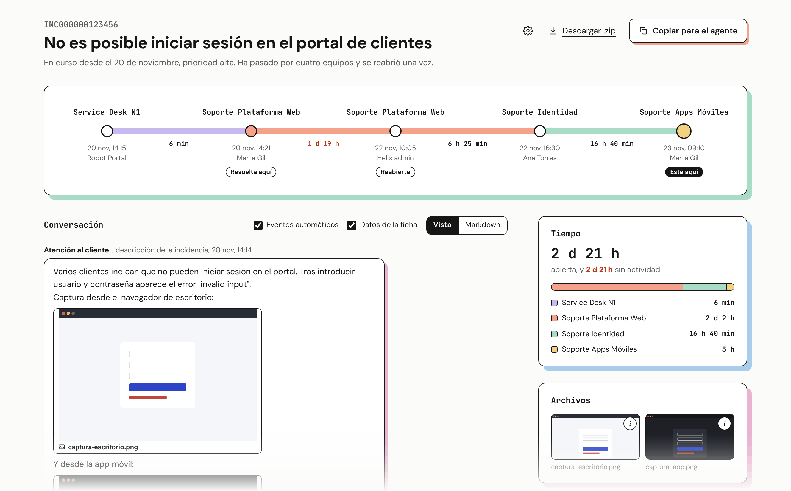

# SmartIT – Exportar incidencia

Extensión de Chrome para **BMC Helix SmartIT** que reúne en una sola pantalla toda la información de una incidencia.

Actualmente, la actividad de SmartIT está paginada y no se puede copiar entera con Ctrl+C / Ctrl+V y los adjuntos solo están disponibles al descargar. Este panel soluciona ese problema de UX.

## Instalación

1. Descarga el .zip
2. Abre `chrome://extensions` y activa el **Modo de desarrollador**.
3. Pulsa **Cargar descomprimida** y elige la carpeta del repositorio.
4. Recarga SmartIT.

## Uso

Abre una incidencia y pulsa el icono 📋 de la cabecera de SmartIT, a la izquierda de la lupa. El contenido de SmartIT se funde a blanco mientras se analiza la incidencia y el visor aparece en su lugar, dentro de la propia página. Para volver a SmartIT, pulsa el icono de nuevo (ahora es una flecha circular) o Esc:

- «Copiar para el agente»: copia toda la incidencia en Markdown. El selector Vista / Markdown muestra ese texto, y hay opciones para incluir o quitar los eventos automáticos (cambios de estado, asignaciones…) y los datos de la ficha.
- Si la incidencia tiene un resumen de HelixGPT, se muestra completo al principio de la conversación y se incluye al principio del Markdown.
- Engranaje de ajustes (arriba a la derecha del visor): tema claro, oscuro o el del sistema, y estilo «Tarjetas» o «Clásico».
- Etiquetas: debajo del título puedes añadir etiquetas (con sugerencias de las que ya usas). Se guardan con la incidencia.
- Relacionadas: en el lateral, las incidencias ya guardadas en tu carpeta que se parecen a la actual (etiquetas, servicio, categoría o título en común), con su causa y solución si están anotadas.
- «Guardar»: guarda en la carpeta que elijas `<incidencia>/incidencia.md` y los adjuntos en `<incidencia>/adjuntos/`, enlazados desde el Markdown, y copia un prompt para pegarlo en tu agente (Copilot CLI u otro). En la raíz de esa carpeta mantiene un `indice.md` de todas las incidencias guardadas (etiquetas, servicio, equipo, solución), un vocabulario `etiquetas.md` y, en cada incidencia, un `clasificacion.md` con etiquetas, causa y solución. La primera vez se pide la carpeta; se puede cambiar en los ajustes de la extensión, donde también se indica la ruta tal como la ve el agente (por ejemplo, desde WSL) y se puede adaptar el prompt que se copia.
- El recorrido de la incidencia entre equipos, con el tiempo en cada uno, dónde se cerró, se reabrió y dónde está ahora.
- La actividad como una conversación, con los tiempos sin actividad, y en el lateral el tiempo por equipo, los adjuntos y la ficha.

## Cómo funciona

| Archivo | Qué hace |
|---|---|
| `top.js` | En la página de SmartIT añade el icono de la cabecera y avisa al iframe de la ficha. |
| `content.js` | En la ficha (Helix Progressive Views) lee los campos, recorre las páginas de la actividad y carga los adjuntos. |
| `main-hook.js` | Observa (sin modificarlas) las peticiones que hace la propia aplicación para reutilizar su cabecera de sesión al pedir los adjuntos. |
| `background.js` | Guarda la exportación, abre el visor y pasa los archivos a guardar a `offscreen.html`. |
| `options.html` / `options.js` | Ajustes de la extensión: carpeta donde guardar y ruta para el agente. |
| `carpeta.js` / `offscreen.html` | Escriben en la carpeta elegida (API de acceso a archivos de Chrome). |
| `viewer.html` / `viewer.js` / `viewer.css` | El visor local. |
| `tests/` | Datos inventados y un generador de páginas para probar el visor sin SmartIT. |

## Privacidad y seguridad

Todo ocurre en local, en tu navegador:

- La extensión no envía datos a ningún servidor externo ni usa analítica. Las únicas peticiones que hace son a tu propia instancia de SmartIT, con tu sesión, igual que si navegaras tú.
- Es de solo lectura: no crea, modifica ni borra nada en SmartIT. Lo único que pulsa son los botones de paginación de la actividad.
- No guarda contraseñas ni tokens. La cabecera de sesión se toma en el momento de las peticiones de la propia página y no se almacena.
- «Guardar» solo escribe dentro de la carpeta que tú elijas, con el permiso que concedes en Chrome. La extensión no conoce la ruta completa de esa carpeta, solo su nombre.
- Una vez al día, como mucho (se puede desactivar en los ajustes de la extensión), descarga el `manifest.json` público de este repositorio para avisar si hay una versión nueva. No envía ningún dato.
- El visor es una página de la propia extensión que se muestra dentro de SmartIT en un marco aislado: SmartIT no puede leer su contenido. Las exportaciones se guardan en el almacenamiento local de la extensión (solo las 10 más recientes) para poder mostrarlas.

## Para quien contribuya

Sube el número de `version` del `manifest.json` en cada cambio que publiques: es lo que usa la extensión para avisar de que hay una versión nueva.

## Licencia

MIT
