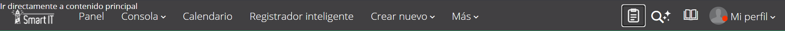

# SmartIT – Exportar incidencia

Extensión de Chrome para **BMC Helix SmartIT** que reúne en una sola pantalla toda la información de una incidencia.

Actualmente, la actividad de SmartIT está paginada y no se puede copiar entera con Ctrl+C / Ctrl+V y los adjuntos solo están disponibles al descargar. Este panel soluciona ese problema de UX.

## Instalación

1. Descarga el .zip
2. Abre `chrome://extensions` y activa el **Modo de desarrollador**.
3. Pulsa **Cargar descomprimida** y elige la carpeta del repositorio.
4. Recarga SmartIT.

## Uso

Abre una incidencia y pulsa el icono 📋 de la cabecera de SmartIT, a la izquierda de la lupa. El contenido de SmartIT se funde a blanco mientras se analiza la incidencia y el visor aparece en su lugar, dentro de la propia página. Para volver a SmartIT, pulsa el icono de nuevo (ahora es una flecha circular) o Esc:

- La información de la incidencia con formato, con el enlace «Pulsa aquí para copiar el markdown completo», el selector Vista / Markdown y opciones para incluir o quitar los eventos automáticos (cambios de estado, asignaciones…) y los datos de la ficha.
- Si la incidencia tiene un resumen de HelixGPT, se muestra completo encima de la descripción y se incluye al principio del Markdown.
- Engranaje de ajustes (arriba a la derecha del visor): tema claro, oscuro o el del sistema.
- «Descargar .zip»: descarga `<incidencia>.zip` con el `incidencia.md` y todos los adjuntos en `adjuntos/`, enlazados desde el Markdown.
- Si la incidencia ha pasado por varios equipos o se ha reabierto, se muestra su recorrido, indicando en qué paso se cerró, se reabrió y cuál es el actual.
- Al final, el carrusel con todos los adjuntos.

## Cómo funciona

| Archivo | Qué hace |
|---|---|
| `top.js` | En la página de SmartIT añade el icono de la cabecera y avisa al iframe de la ficha. |
| `content.js` | En la ficha (Helix Progressive Views) lee los campos, recorre las páginas de la actividad y carga los adjuntos. |
| `main-hook.js` | Observa (sin modificarlas) las peticiones que hace la propia aplicación para reutilizar su cabecera de sesión al pedir los adjuntos. |
| `background.js` | Guarda la exportación y abre el visor. |
| `viewer.html` / `viewer.js` / `viewer.css` | El visor local. 

## Privacidad y seguridad

Todo ocurre en local, en tu navegador:

- La extensión no envía datos a ningún servidor externo ni usa analítica. Las únicas peticiones que hace son a tu propia instancia de SmartIT, con tu sesión, igual que si navegaras tú.
- Es de solo lectura: no crea, modifica ni borra nada en SmartIT. Lo único que pulsa son los botones de paginación de la actividad.
- No guarda contraseñas ni tokens. La cabecera de sesión se toma en el momento de las peticiones de la propia página y no se almacena.
- Una vez al día, como mucho, descarga el `manifest.json` público de este repositorio para avisar si hay una versión nueva. No envía ningún dato.
- El visor es una página de la propia extensión que se muestra dentro de SmartIT en un marco aislado: SmartIT no puede leer su contenido. Las exportaciones se guardan en el almacenamiento local de la extensión (solo las 10 más recientes) para poder mostrarlas.

## Para quien contribuya

Sube el número de `version` del `manifest.json` en cada cambio que publiques: es lo que usa la extensión para avisar de que hay una versión nueva.

## Licencia

MIT
